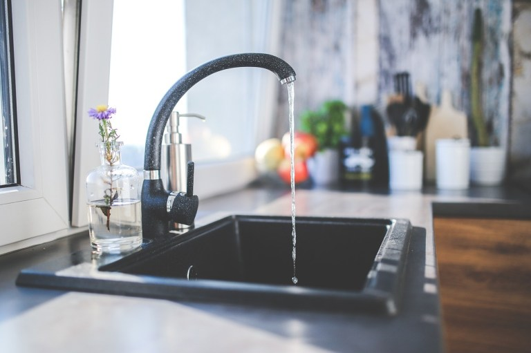

  <figure>
  
  <figcaption><em>Image by - pixabay.com</em></figcaption>
</figure> 
In today’s convenient world, we often don’t think twice before wasting water on unnecessary things such as running the tap, waiting for the correct temperature or just to enjoy the water drippings. When we run a long bath, flush the toilet, excessively wash dishes, brush our teeth or spend extra time in the shower just because we feel like it – it can be easy to forget about those who are in desperate need for something we all too often waste.

Today I woke up at 7 o' clock in the morning. With the opening of my eyes, I ran towards the motor switch to check if water was coming. After a few minutes, I came to realise that water was not coming and the water tank was also empty.

> *O Children of Adam! Dress properly whenever you are at worship. Eat and drink, but do not waste. Surely He does not like the wasteful.*

> — The Holy Quran, 7:31

I became very uneasy as there was no water anywhere to use in the washroom. Without water, how do you brush? Get fresh?. Many questions like this started to flood into my mind. I was seated trying to figure out how to spend the day today without water. Get water from anywhere. And at the same time, checking again and again by switching the motor on and off.

Then after some time, probably at 9 o'clock, my cook (didi) also came, when she realised that there was no water drop coming out of the tap. She also expressed her concern of getting late as she had to go to another house to cook after cooking here. Somehow we managed to arrange enough water for the time. For a while, the problem was resolved. And I went to the library (reading room).

The day passed without water. I have faced this in Delhi many times but today was quite the most difficult day and I realised the importance of water throughout the day. As Benjamin Franklin quote, *"When the well is dry, we know the worth of water"*. My mind gets reminded again and again of the importance of water my parents had told at home and the importance of water/ resources our religion teaches us. Due to the abundance of water in my home state, the Terai region of Bihar, we never felt the scarcity of water there, but here in Delhi the demand for everything is much higher than its supply.
