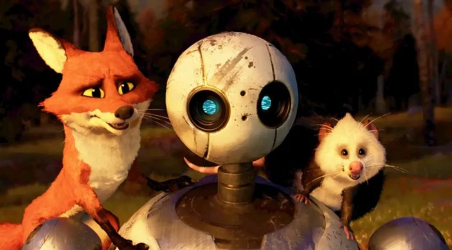

<figure>
  
</figure>

It's 2.03 am midnight; I want to sleep early. I want to fix my sleep cycle; I've been trying to sleep for the past 2 and a half hours but couldn't. I don't know what's going on in my mind right now. Too many thoughts are passing by, and nothing is clear; it makes it complicated. I grabbed my phone to write it all but can't write any of it. Perhaps sometimes I can't comprehend my own thoughts. but I will try...

Sometimes I start to think about the characters of the movies I watched recently; sometimes I think about my studies, and sometimes about the world events. I just played a song and started to think about that as well. Recently I discovered a song, and since then I've been listening to it in a loop.

Recently I watched a movie, *The Wild Robot*. Some of the scenes of the movie are hitting me in my mind right now. It's a science fiction animated movie based on a novel of the same name. A robot named Roz fell down on an island where a variety of wildlife are residing. Accidentally, Roz kills a nesting goose, and she finds an egg there. Takes on the task of adopting the orphaned gosling, whom she names Brightbill. After spending some time together, Roz, Brightbill, and a fox named Fink feel attached to each other. They trained Brightbill for the winter migration. Roz develops an emotional feeling for Brightbill; she doesn't communicate it to her. When Brightbill leaves for the winter migration, Roz misses Brightbill badly. She was sitting alone on the high edge of the bank of the sea. Fink comes after her. Emotionally, Roz asks Fink, *'How do you know if you love something/someone?'*

Fink, with a heavy heart, replies, *'If you do, you should probably tell them.'*

'Roz—*What if it is too late?*'

'*I wouldn't know,*' Flink replied and suddenly disappeared as if he's also hiding his own emotions.

In the air while flying, 'Longneck,' the leader of the goose winter migration, asks Brightbill if something is on her mind.

To which Brightbill replies, '*I forgot to say something after I left,*' referring to Roz and Fink.

'*Sometimes hearts have their own conversations.*' Longneck prompted and continued their flying.

I don't know why this scene is stuck in my mind right now. Please bear with me.

Still so many things hitting in my mind. I'll try to sleep now again.

Thanks.